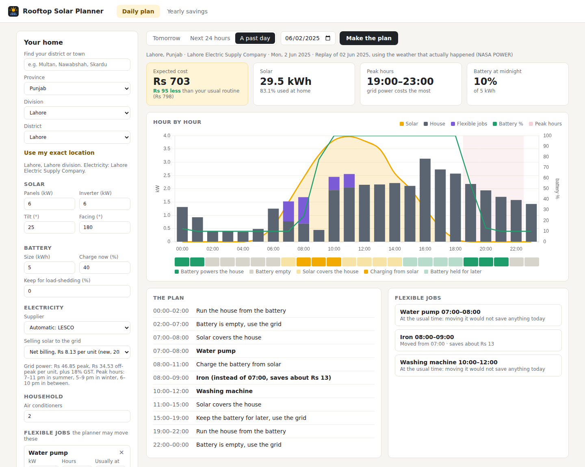
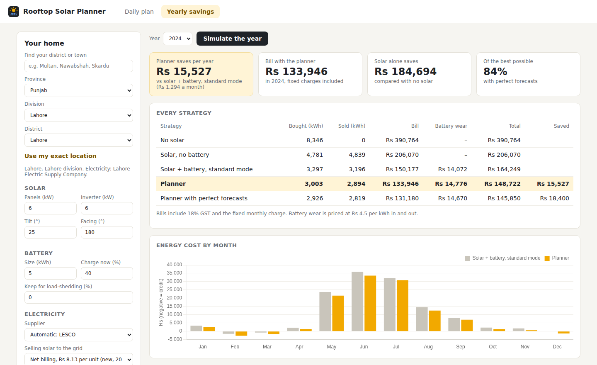

# Rooftop Solar Planner

A day-ahead planner for homes with rooftop solar and a battery, anywhere in Pakistan. It
takes the live weather forecast for your district, works out how much the panels will
produce and how much the house will use, and tells you what to do hour by hour: when to
let the battery run the house, when to save it for the evening peak, whether to top it up
from the grid at night, and when to run the water pump, washing machine and iron.

It covers all 178 districts in 41 divisions across the four provinces, Islamabad,
Gilgit-Baltistan and Azad Kashmir. Each district knows its electricity supplier (LESCO,
K-Electric, HAZECO and the rest), and the supplier sets the peak hours and prices.



## User guide

Just want to use the app? The user guide walks through every part of the screen, step by step,
with labelled pictures:

- **[User guide (read on GitHub)](docs/USER_GUIDE.md)**
- **[User guide (PDF, to download or print)](docs/User_Guide.pdf)**

The rest of this page is about how the planner works and how well it does.

## Why

Most hybrid inverters in Pakistan run in "self-use" mode: solar first, then the battery,
then the grid. That was fine under net metering, when exported units earned almost as
much as imported ones cost. Since February 2026 new solar connections are on **net
billing**: units you buy cost Rs 34.53 off-peak and Rs 46.85 at peak (plus 18% GST),
while units you sell earn Rs 8.13. The value is now in using your own solar at the right
time, and self-use mode doesn't know what time it is.

- It drains the battery in the afternoon if a cloud passes or the AC kicks in, and then
  the house is on peak-rate grid power from 7 to 11 pm.
- It never charges from the grid, even when a cheap off-peak kWh at 2 am would replace an
  expensive one at 9 pm.
- It doesn't know the pump and the washing machine could run at noon on free solar
  instead of at 7 am on the grid.

The planner does know those things. It solves the day as a small optimisation problem.

## Where it works

Pick a province, then a division, then a district, or type a district or town name (or
share your exact location). The supplier is filled in automatically and can be changed.

| Supplier | Area | Peak hours |
|---|---|---|
| LESCO, GEPCO, FESCO, IESCO, MEPCO | Punjab and Islamabad | Dec–Feb 5–9 pm · Mar–May, Sep–Nov 6–10 pm · Jun–Aug 7–11 pm |
| PESCO, HAZECO, TESCO | Khyber Pakhtunkhwa (Hazara division, merged tribal districts) | same national schedule |
| HESCO, SEPCO | Sindh outside Karachi | same national schedule |
| QESCO | Balochistan | same national schedule |
| K-Electric | Karachi, Hub, Lasbela | Apr–Oct 6:30–10:30 pm · Nov–Mar 6–10 pm |
| AJK Electricity Department | Azad Kashmir | flat Rs 6 per unit (over 300 units a month) |
| GB Water and Power Department | Gilgit-Baltistan | flat rate, entered from your bill |

Prices are the same national tariff for every company (see [Tariff](#tariff-2026-defaults-all-adjustable)).
K-Electric's half-hour peak boundaries are priced by the fraction of each hour that falls in the peak.

Plans come in three kinds:

- **Tomorrow**: the whole of tomorrow from the live Open-Meteo forecast. This is the main use: plan in the evening, set the inverter, done.
- **Next 24 hours**: from the current hour onwards, for re-planning during the day when the weather turns or the battery isn't where you expected. Jobs whose usual time has already passed today count as done.
- **A past day**: any day since 2018, with the weather that actually happened, to see what the plan would have done.

Weather history for the past-day mode and the yearly simulation is downloaded for each
district the first time it's used (Open-Meteo's ERA5 archive, with NASA POWER as the
fallback) and cached in `data/cache/`. Lahore's history ships with the project.

## What it saves

Every hour of 2024 in Lahore (LESCO), replayed using real NASA weather and a modelled 10-marla
house with two inverter ACs (8,346 kWh a year). The planner only sees forecasts made
the evening before. It never sees the actual weather in advance. Bills include GST,
the fixed charge and Rs 4.5 per kWh of battery wear.

| System | Standard inverter mode | Planner | Saved per year | Of the best possible* |
|---|---:|---:|---:|---:|
| 6 kW panels, 5 kWh battery | Rs 164,249 | Rs 148,722 | **Rs 15,527** | 84% |
| 10 kW panels, 5 kWh battery | Rs 99,104 | Rs 86,519 | **Rs 12,584** | 87% |
| 10 kW panels, 10 kWh battery | Rs 71,069 | Rs 64,597 | **Rs 6,472** | 70% |
| 6 kW panels, no battery | Rs 206,070 | Rs 192,955 | **Rs 13,115** | 89% |
| 10 kW panels, no battery | Rs 144,080 | Rs 136,164 | **Rs 7,916** | 82% |
| 10 kW + 10 kWh, old net metering | Rs −50,193 | Rs −56,103 | **Rs 5,910** | 76% |

\* compared with the same planner given perfect knowledge of tomorrow's weather and load.
Without a battery, "standard" means the jobs run at their usual times. A negative amount is a
credit: the solar sold to the grid was worth more than the electricity bought.

For the 6 kW + 5 kWh house, about Rs 4,700 comes from battery timing alone and the rest
from moving the flexible jobs into sunny hours. The same system in 2023 saves Rs 16,197.
For scale: with no solar that house pays Rs 390,764 a year, and the panels on their own
save Rs 184,694. The planner makes a good system better, but the panels do most of the work.

The pattern makes sense. Savings are largest for small systems, where solar is scarce
and timing matters. A big battery on a big array covers the evening anyway, so there is
less left to optimise. Under the old net-metering rates, exporting is almost as good as
using the power yourself, so moving loads is worth less.



## How it works

```
weather forecast ──► PV model ──────────┐
(Open-Meteo, per     (pvlib)            │
 district)                              │
                                        ├──► MILP optimiser ──► hour-by-hour plan
load history ─────► load forecast ──────┤    (HiGHS, < 0.1 s)   + job times
                    (gradient boosting) │
tariff + supplier's peak hours ─────────┘
```

**Solar.** Irradiance goes through a proper PV model: Perez transposition onto the tilted
panels, incidence-angle losses, cell temperature from air temperature and wind, a
temperature-dependent DC output and the inverter limit. Default losses (soiling, wiring,
mismatch, ageing) come to about 13%. In Lahore this gives 1,400–1,470 kWh per kW of
panels a year, which matches what local installers quote.

**Forecasts.** In the app, tomorrow's irradiance and temperature come from Open-Meteo's
forecast for the district's coordinates.
For the backtest there is no archive of old weather forecasts, so a gradient-boosted model
predicts tomorrow's clear-sky index from observations up to the evening before. It is a
weaker forecast than a real weather model, which makes the savings above conservative.
Household load is forecast the same way, from recent days and temperature.

Held-out year 2024 (`python scripts/forecast_accuracy.py`):

| Solar, next day | Hourly RMSE (kW per kW) | Daily energy error |
|---|---:|---:|
| Model | **0.106** | **18.6%** |
| Tomorrow = today | 0.119 | 18.9% |
| Monthly average | 0.115 | 21.3% |

| Household load, next day | Mean absolute error |
|---|---:|
| Model | 20.8% |
| Tomorrow = today | 22.2% |
| Last 7 days average | 20.6% |

The load model is only on par with a 7-day average. Most of the hour-to-hour variation in
the simulated house is random by design, so there isn't much more to find.

**Optimiser.** A mixed-integer linear programme over the next 48 hours (`scipy.optimize.milp`
with HiGHS). Each hour has variables for grid import and export, battery charge and
discharge, stored energy and curtailment. Each flexible job gets a binary for every
allowed start time. The objective is the energy bill plus battery wear, with a small
penalty per hour a job is moved from its usual time, so it isn't moved for a few paisa.
Leftover battery energy at the end of the horizon is valued at the cheapest grid price.

**Running the day.** In the backtest the plan is made the evening before and job times are
fixed from that plan. The battery is then re-planned every hour as the day unfolds, the way
a real controller would be. Safety rules always apply: surplus solar is never wasted if the
battery has room, and the battery never discharges into the grid.

## Tariff (2026 defaults, all adjustable)

| | |
|---|---|
| Peak / off-peak | Rs 46.85 / Rs 34.53 per unit + 18% GST (S.R.O. 279(I)/2026, 12 Feb 2026) |
| Peak hours | national schedule for the state-owned companies; K-Electric's own (see [Where it works](#where-it-works)) |
| Selling to the grid | Rs 8.13 net billing (new connections from Feb 2026), Rs 25.32 old net metering |
| Fixed charge | Rs 675 per kW per month on half the sanctioned load |

Fuel price adjustments and other surcharges change every month and aren't included. They
move all strategies' bills together, so they barely affect the comparison. The prices
apply to homes with a sanctioned load of 5 kW or more, which is almost every home with
rooftop solar.

## Running it

Python 3.11 or newer.

```bash
pip install -r requirements.txt
python -m uvicorn server.app:app --port 8000     # or run.bat / run.sh
```

Then open http://localhost:8000. Pick your district, set up your home on the left
(panels, battery, number of ACs, flexible jobs) and press **Make the plan**. The
**Yearly savings** tab replays a whole year for your district and settings (about a
minute). The [user guide](docs/USER_GUIDE.md) explains every part of the screen.

Command line:

```bash
python -m solarplan plan --place multan --pv-kw 6 --battery-kwh 5 --battery-now 40   # tomorrow, live forecast
python -m solarplan plan --place "tando allahyar" --start now                         # the next 24 hours
python -m solarplan plan --place skardu --rate 11                                     # flat-rate supplier
python -m solarplan plan --lat 33.64 --lon 72.99                                      # any point in Pakistan
python -m solarplan plan --place lahore --date 2025-06-02                             # replay a past day
python -m solarplan backtest --place sukkur --year 2024 --pv-kw 6 --battery-kwh 5
python -m solarplan places hazara                                                     # list districts
```

```
Lahore, Punjab, 2025-06-02 from 00:00  (replay of 2025-06-02, actual weather from NASA POWER)
electricity: Lahore Electric Supply Company
solar 29.5 kWh, 83.1% used at home; peak hours 19:00-23:00
expected energy cost Rs 703  (usual routine: Rs 798)

  00:00-02:00  Run the house from the battery
  02:00-07:00  Battery is empty, use the grid
  07:00-08:00  Water pump
  08:00-11:00  Charge the battery from solar
  08:00-09:00  Iron (instead of 07:00, saves about Rs 13)
  10:00-12:00  Washing machine
  ...
  15:00-19:00  Keep the battery for later, use the grid
  19:00-22:00  Run the house from the battery
```

The expected cost includes battery wear, and energy left in the battery at the end is
credited at what it will replace the next evening, so the plan and the usual routine are
compared on equal terms. A negative cost means the day ends in credit: on a sunny day a large
system sells more solar and stores more energy than the house buys, so the family earns rather
than pays.

To prepare a machine that will be offline later, download history ahead of time:

```bash
python scripts/download_weather.py multan skardu turbat
python scripts/download_weather.py --province Sindh
```

Tests and lint:

```bash
pip install -r requirements-dev.txt
ruff check .
pytest
```

## Project layout

```
data/
  pakistan_districts.csv   every district: province, division, main town, coordinates, supplier
solarplan/
  locations.py    district lookup, search, custom points
  weather.py      Open-Meteo forecast and archive, NASA POWER, caching
  history.py      weather history per district (bundled, cached or downloaded)
  pv.py           PV system model (pvlib)
  household.py    appliance-level household load model and flexible jobs
  tariff.py       suppliers, ToU prices and peak hours, net billing, monthly bill
  forecast.py     next-day solar and load forecasts
  optimizer.py    MILP for battery and job scheduling
  simulate.py     hour-by-hour execution of each strategy over a year
  backtest.py     builds a year of inputs and compares strategies
  planner.py      the day's plan in plain words
  cli.py          command line
server/           FastAPI backend and the dashboard (plain JS + Chart.js)
docs/             user guide (Markdown and PDF), screenshots
scripts/          weather download, forecast accuracy
tests/
```

## Limitations

- The household is modelled, not metered. The appliance model is calibrated to a typical
  Lahore house (about 7,000 kWh in a normal year, more in the 2024 heatwave). Air
  conditioning follows each district's real temperature, but space heating isn't modelled,
  so winter use in Quetta, Murree, Gilgit-Baltistan and the northern valleys will be
  underestimated. If you have hourly meter or inverter data, `plan --load-csv usage.csv`
  uses it instead (a CSV of timestamp and kW; the last two weeks are enough).
- The savings table is for Lahore, the one district whose history is bundled. Other
  districts can be simulated the same way once their history is downloaded.
- Gilgit-Baltistan's electricity price isn't published in a usable form, so you enter it.
  In AJK and GB, selling solar back to the grid is assumed not to be available; if your
  connection has it, set the supplier to your nearest state-owned company.
- K-Electric's peak windows come from consumer guides rather than the tariff order.
  Check them against your bill.
- District coordinates are those of the main town. For big districts, "Use my exact
  location" (or `--lat/--lon`) gives a better forecast.
- The live forecast and history downloads were tested against recorded responses in the
  documented format, not against the live services. Check the first few plans against what
  actually happens.
- The planner tells you what to do; it doesn't control the inverter. Most hybrid inverters
  let you set charge-from-grid windows and battery-priority times, and the plan maps onto
  those settings.
- Load-shedding isn't simulated. Use the reserve setting to keep part of the battery for it.

## Data and credits

- Weather history: NASA POWER hourly data. *These data were obtained from the NASA Langley
  Research Center (LaRC) POWER Project funded through the NASA Earth Science/Applied Science
  Program.*
- Weather forecasts and archive: [Open-Meteo](https://open-meteo.com) (CC BY 4.0). The
  archive is ERA5 reanalysis and contains modified Copernicus Climate Change Service information.
- District coordinates: [GeoNames](https://www.geonames.org) (CC BY 4.0), checked against the
  district list; administrative divisions as of 2025.
- PV modelling: [pvlib python](https://pvlib-python.readthedocs.io).
- Tariffs: NEPRA notifications for 2026, the supplier companies' published peak hours, and the
  AJK government's 2024 domestic rates.
- Charts: [Chart.js](https://www.chartjs.org) (MIT), included in `server/static/vendor`.

## License

MIT
