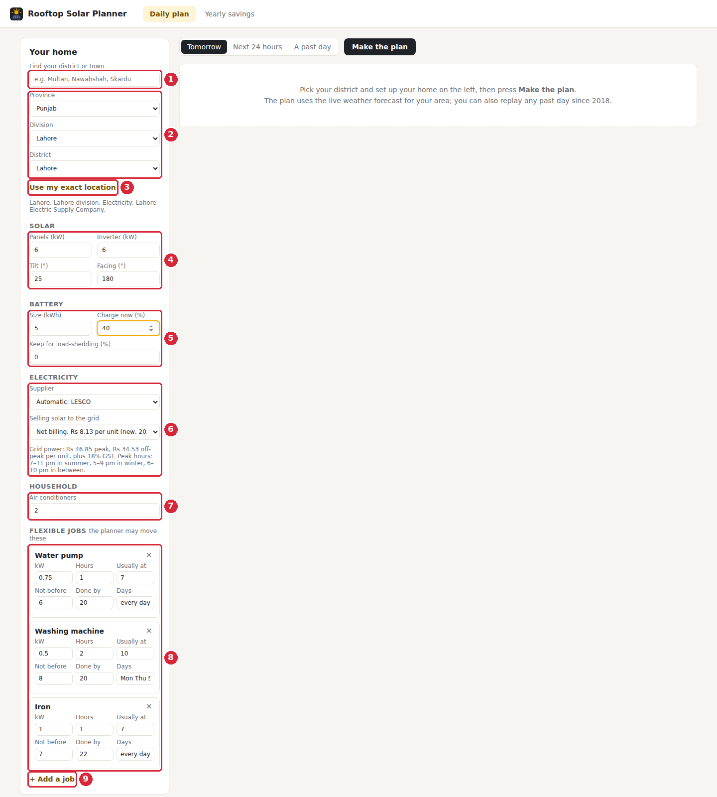
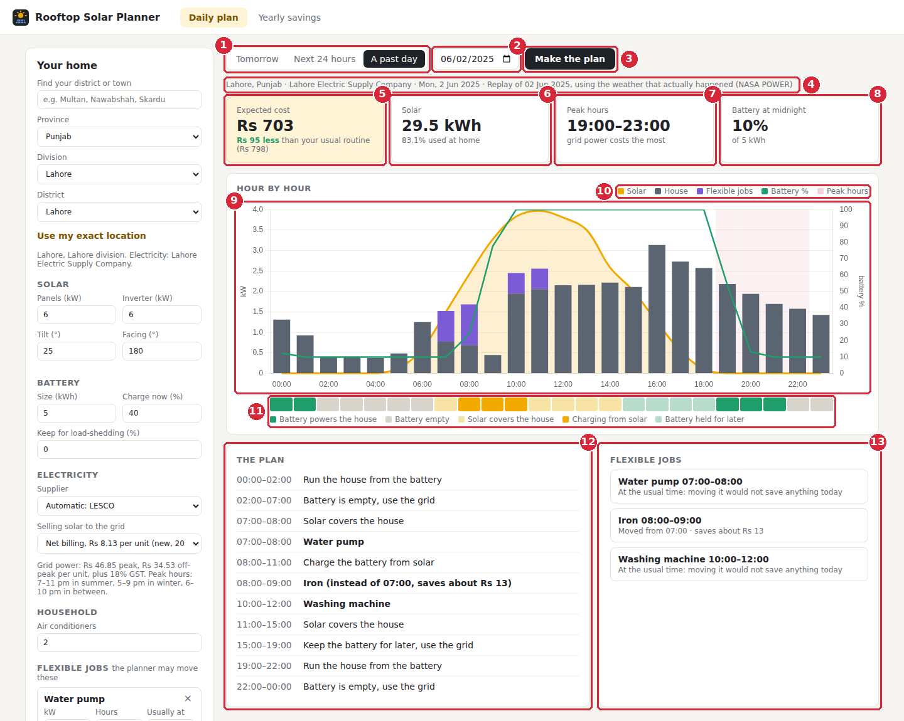
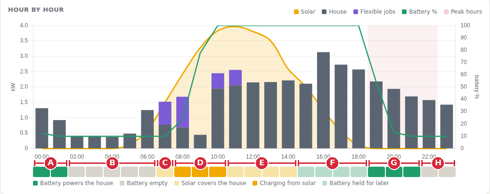
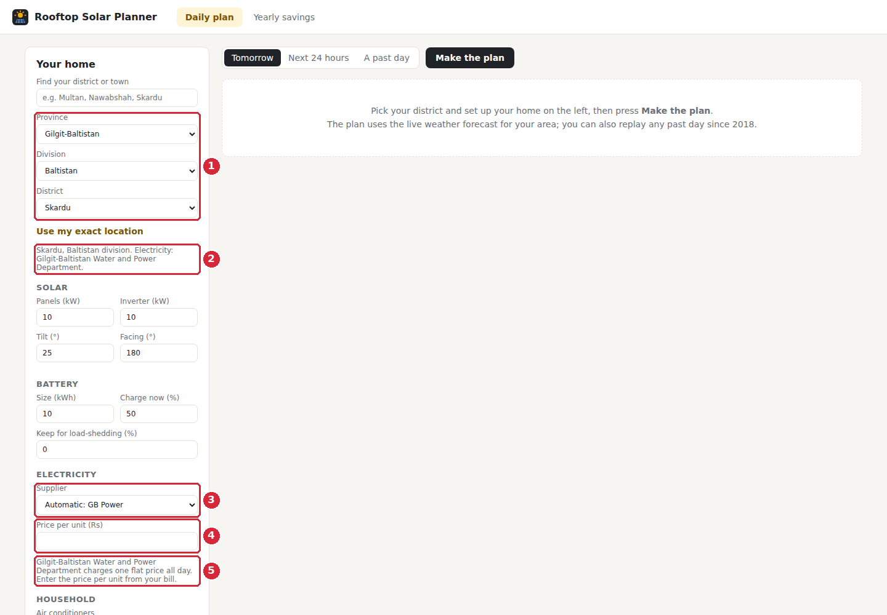
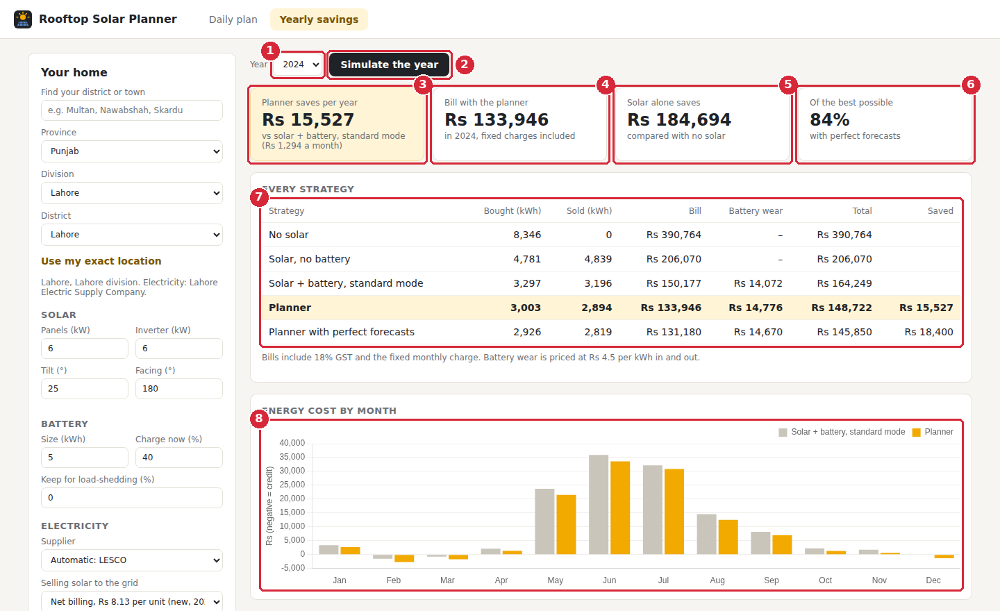

# Rooftop Solar Planner: User Guide

This guide is for people using the app to plan their home's electricity. It explains every part of the screen, step by step. How the planner works inside (forecasting, the optimiser, the test results) is described separately in the [project README](../README.md).

In one sentence: you tell the app about your home, it reads the weather forecast for your district, and it tells you when to use your battery and when to run heavy chores so that you pay the least for electricity.

A printable copy of this guide is in [User_Guide.pdf](User_Guide.pdf).

**Contents**

1. [Start the app](#start-the-app)
2. [Step 1: Set up your home](#step-1-set-up-your-home)
3. [Step 2: Make the plan](#step-2-make-the-plan)
4. [Step 3: Read the plan](#step-3-read-the-plan)
5. [Step 4: Follow the day on the graph](#step-4-follow-the-day-on-the-graph)
6. [Areas with one flat price (Azad Kashmir and Gilgit-Baltistan)](#areas-with-one-flat-price-azad-kashmir-and-gilgit-baltistan)
7. [Step 5: See your yearly savings](#step-5-see-your-yearly-savings)
8. [Using it day to day](#using-it-day-to-day)
9. [Common questions](#common-questions)

## Start the app

1. Install Python 3.11 or newer from python.org. During installation, tick **Add python.exe to PATH**.
2. Unzip the project folder and double-click **run.bat** (on Mac or Linux, run **run.sh**).
3. The first start downloads the software it needs and takes a few minutes. After that it starts in a few seconds.
4. Your browser opens **http://localhost:8000** by itself. If the page is blank, wait a moment and refresh.
5. Keep the black command window open while you use the app. Closing it stops the app.

The app runs on your own computer. It needs the internet only to fetch weather forecasts, and to download a district's past weather the first time you use it.

## Step 1: Set up your home

Everything about your home is entered in the panel on the left. You only need to do this once; the values stay while the page is open.

*The settings panel on the left side of the page.*

| # | Part | What it means |
|:---:|---|---|
| **1** | Find your district or town | Type a name, for example Multan, Nawabshah or Skardu, and pick it from the list. Small spelling mistakes are fine. This fills in the three menus below for you. |
| **2** | Province, Division, District | Or choose your area step by step. Every district of Pakistan is listed, in all four provinces, Islamabad, Gilgit-Baltistan and Azad Kashmir. The line underneath confirms the place and your electricity company. |
| **3** | Use my exact location | Uses your computer's location instead of the district's main town. This gives a more accurate forecast in large districts. The browser asks for permission first. |
| **4** | Solar | **Panels (kW)** is the size of your solar system, written on your installer's quote (for example 6 kW). **Inverter (kW)** fills in automatically. **Tilt** is the angle of the panels (about 25 degrees is common) and **Facing** is their direction: 180 means south, which is best in Pakistan. |
| **5** | Battery | **Size (kWh)** is your battery's capacity; enter 0 if you have none. **Charge now (%)** is how full it is at the moment; read it from your inverter's screen or app. **Keep for load-shedding** is a share the planner will never use, so it is always there for power cuts. |
| **6** | Electricity | Your supplier (LESCO, K-Electric, MEPCO and so on) is chosen automatically from your district; change it only if your bill says otherwise. Under **Selling solar to the grid**, choose **Net billing** for connections made from February 2026, or **Old net metering** if your connection is on the older agreement. The grey text shows your prices and peak hours. |
| **7** | Air conditioners | How many ACs the house has. Air conditioning is the biggest electricity use, so this, together with the day's temperature, tells the app how much power your home will need. |
| **8** | Flexible jobs | Chores that must be done but whose time can move: the water pump, washing machine and iron. For each one: **kW** is its power, **Hours** how long it runs, **Usually at** the time your family normally runs it, **Not before** and **Done by** the window it may run in, and **Days** which days it runs (for example "Mon Thu Sat" or "every day"). The x removes a job. |
| **9** | Add a job | Add another chore, for example an electric motor or car charging. |

## Step 2: Make the plan

*A finished plan. The numbers are explained below.*

| # | Part | What it means |
|:---:|---|---|
| **1** | Which day to plan | **Tomorrow** plans the whole of tomorrow from the live weather forecast. Use this every evening. **Next 24 hours** plans from the current hour, for when the weather changes during the day or the battery is not where you expected; chores whose usual time has already passed today count as done. **A past day** replays any day since 2018 with the weather that really happened, which is useful for trying the app out. |
| **2** | Date | Only shown for A past day. The first time you use a district, its past weather is downloaded, which takes a few seconds. |
| **3** | Make the plan | Press this after any change. |

## Step 3: Read the plan

The same picture as in Step 2, continued.

| # | Part | What it means |
|:---:|---|---|
| **4** | Information line | Place, electricity company, the day, and where the weather came from. |
| **5** | Expected cost | What electricity will cost you that day if you follow the plan (grid power bought, minus solar sold, plus a small amount for battery wear). The line underneath compares it with your **usual routine**: chores at their usual times and the inverter in its normal mode. "Rs 95 less" is the day's saving. A **negative** cost, such as −Rs 136, means you earn money that day instead of paying: the solar you sell, plus the extra energy stored in the battery for tomorrow, is worth more than the electricity you buy. |
| **6** | Solar | How much electricity your panels will produce that day, and how much of it the house uses itself. The rest is sold to the grid. |
| **7** | Peak hours | The most expensive hours of the day for your supplier. Outside these hours grid power is cheaper. Suppliers with one flat price all day show None here. |
| **8** | Battery at midnight | How full the battery will be at the end of the planned period. The planner never empties it below 10%, to protect the battery. |
| **9** | Hour by hour graph | The whole day at a glance, from midnight on the left to 11 pm on the right. Step 4 explains how to read it. |
| **10** | Graph key | **Yellow curve**: power from your panels. **Grey bars**: what the house uses. **Purple** on top of the bars: the flexible jobs. **Green line**: how full the battery is, read on the right-hand scale from 0 to 100%. **Pink band**: peak hours. |
| **11** | Battery strip | One box per hour showing what the battery does: dark green, it powers the house; orange, it charges from solar; light green, it is full but kept for later; blue, it charges from the grid; light yellow, solar alone covers the house; grey, the battery is empty and the house uses the grid. |
| **12** | The plan | The same plan as a list of instructions in time order. Bold lines are chores. When a chore is moved, the line says from when and roughly how much it saves. |
| **13** | Flexible jobs | One card per chore with its planned time. A chore is only moved when that actually saves money; otherwise the card says it stays at the usual time. |

## Step 4: Follow the day on the graph

This is the graph from the example plan (Lahore, 6 kW of panels, 5 kWh battery that is 40% full at midnight). The letters mark each part of the day.

*The hour-by-hour graph with the parts of the day marked A to H.*

| # | Part | What it means |
|:---:|---|---|
| **A** | Midnight to 2 am | The battery runs the house. The green line falls from 40% to 10%. |
| **B** | 2 am to 7 am | The battery is empty, so the house uses the grid. Night-time power is at the cheaper rate, so this is fine. |
| **C** | 7 am to 8 am | The sun is up and covers the house. The water pump runs now (purple). |
| **D** | 8 am to 11 am | Solar charges the battery. The green line climbs to 100%. The iron is moved from 7 to 8 am so that more of it runs on sunshine. |
| **E** | 11 am to 3 pm | The battery is full and solar alone runs the house, including the washing machine. Extra solar is sold to the grid. |
| **F** | 3 pm to 7 pm | The important part. The battery is full, but the plan says keep it and use the grid for now, because grid power is cheaper now than it will be after 7 pm. |
| **G** | 7 pm to 10 pm | Peak hours (pink band). The battery runs the house exactly when grid power costs the most. |
| **H** | 10 pm to midnight | The battery is used up and the house uses the grid again. A bigger battery would also cover these hours. |

## Areas with one flat price (Azad Kashmir and Gilgit-Baltistan)

In AJK and Gilgit-Baltistan electricity is sold at one flat price all day, so there are no peak hours. The planner then focuses on using as much of your own solar as possible.

*Skardu selected: the app asks for the price per unit.*

| # | Part | What it means |
|:---:|---|---|
| **1** | Your district | Here Skardu, in Baltistan division. |
| **2** | Your electricity supplier | Filled in automatically: the Gilgit-Baltistan Water and Power Department. |
| **3** | Supplier | Shows the automatic choice. You can change it if your bill says otherwise. |
| **4** | Price per unit (Rs) | Appears only for flat-price suppliers. For Azad Kashmir it is filled in with Rs 6. For Gilgit-Baltistan you must type the price from your electricity bill before making a plan. |
| **5** | Price note | Explains the pricing. Selling solar to the grid is not offered here, so that menu is hidden. |

## Step 5: See your yearly savings

Open the **Yearly savings** tab at the top of the page. It replays every hour of a real past year for your home and settings, and compares five ways of running it. This answers the question: how much would the planner really save me in a year?

*Yearly savings for the example home in Lahore, 2024.*

| # | Part | What it means |
|:---:|---|---|
| **1** | Year | Choose a past year. |
| **2** | Simulate the year | Starts the calculation. It takes about a minute; a bar shows the progress. The first time for a district, its past weather is downloaded first. |
| **3** | Planner saves per year | The main result: how much less you pay with the planner than with a normal solar and battery system, per year and per month. |
| **4** | Bill with the planner | Your whole year's electricity bill, fixed monthly charges included. |
| **5** | Solar alone saves | What the solar panels save compared with having no solar at all. The panels do most of the saving; the planner adds to it. |
| **6** | Of the best possible | The planner only sees forecasts, which are sometimes wrong. The app also runs a version that knows the weather in advance, which gives the most that could possibly be saved. This card shows how close the real planner gets. |
| **7** | Every strategy | Five ways of running the same home: no solar; solar without a battery; solar and battery in the inverter's normal mode (most homes today); the planner; and the planner with perfect forecasts. **Bought** and **Sold** are units taken from and sent to the grid. **Battery wear** puts a price on the battery wearing out as it charges and discharges. **Total** is the bill plus wear, and **Saved** compares each planner row with the normal mode. |
| **8** | Energy cost by month | Grey bars: normal mode. Orange bars: with the planner. Summer months are highest because of air conditioning. A bar below zero means that month's solar sales were larger than the power bought. |

## Using it day to day

1. Each evening, enter the battery's current charge and press **Make the plan** with **Tomorrow** selected.
2. Set your inverter to match. Most hybrid inverters let you choose times when the battery is used or kept, and times when it may charge from the grid. Use the battery strip and the plan list as your guide.
3. Tell the family when to run the pump, washing machine and iron, using the Flexible jobs cards.
4. If the weather changes a lot during the day, use **Next 24 hours** to plan again from now.

The planner gives advice; it does not control your inverter. Nothing changes unless you change the settings yourself.

## Common questions

**It says it could not reach the weather forecast service.**  
The computer is offline or the forecast website did not answer. Check the internet connection and try again. You can still use A past day.

**It says it could not download weather history.**  
The first use of a district needs the internet to download its past weather. Once downloaded, it is kept on your computer and works offline.

**Why is the expected cost negative, for example −Rs 136?**  
A negative cost is money in your favour. It is worked out as: electricity bought from the grid, minus solar sold to the grid, plus battery wear, minus the value of extra energy left in the battery for tomorrow. On a sunny day with a large system, the panels make much more than the house uses, so the total goes below zero. For example: bought Rs 300, sold Rs 350, battery wear Rs 40 and battery energy kept for tomorrow worth Rs 126 gives 300 − 350 + 40 − 126 = −Rs 136, a credit of Rs 136.

**The plan saves nothing today.**  
That happens on some days, for example when the battery is small and the day is cloudy. The planner only asks you to change your routine when it saves money.

**My usage is different from the graph.**  
The app estimates a typical home from the number of ACs and the temperature. Heaters are not included, so winter use in cold areas is shown too low. The plan is still useful, but the rupee amounts are estimates.

**Why is the battery kept full in the afternoon instead of being used?**  
Because the same unit of electricity costs more in the evening peak. Using the grid in the afternoon and the battery in the evening is cheaper overall.
